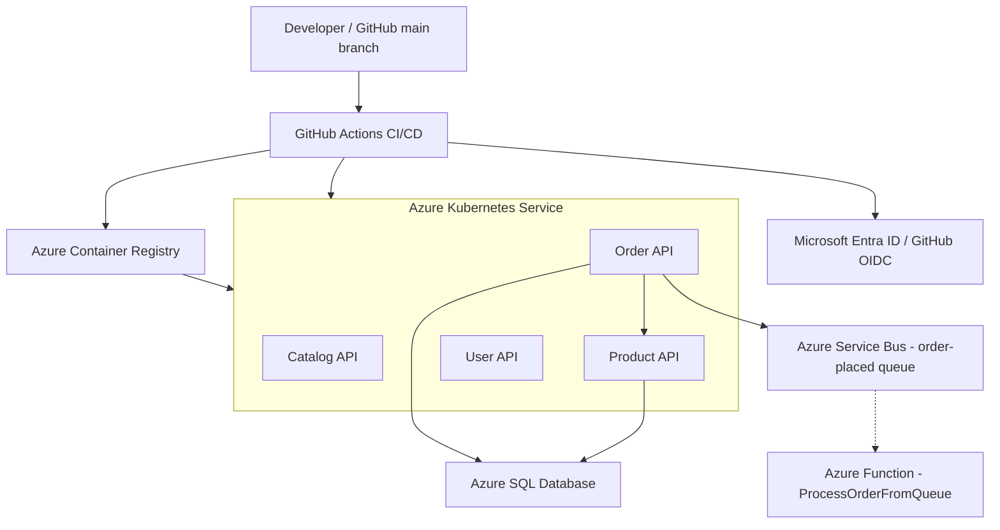
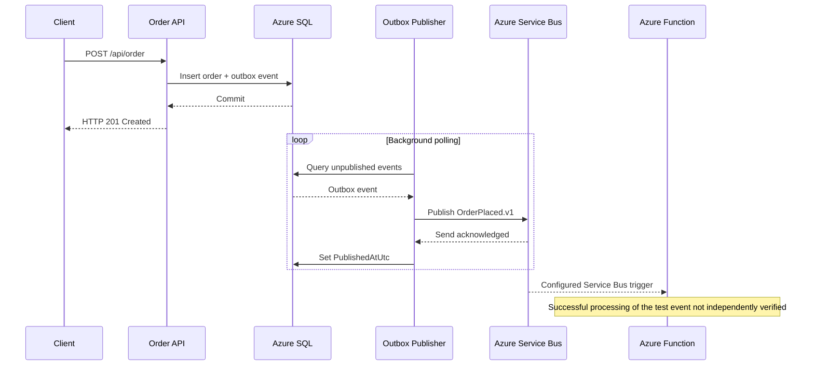
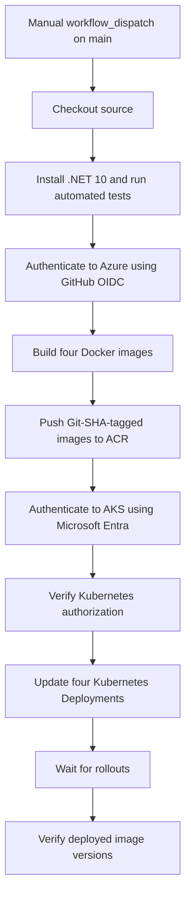

# MonolithToMicro

**Enterprise Application Modernization | .NET 10 | Microsoft Azure | Microservices | Kubernetes | GitHub Actions CI/CD**

A hands-on Azure cloud engineering and DevOps portfolio project demonstrating how to design, containerize, secure, and deploy independently deployable ASP.NET Core microservices using Microsoft Azure.

The project includes four .NET 10 APIs, Azure SQL Database, Azure Container Registry, Azure Kubernetes Service (AKS), Microsoft Entra authentication, GitHub Actions CI/CD, and an event-driven integration using Azure Service Bus and Azure Functions.

> **Project scope:** This is an architecture-focused proof of concept, not a completed migration of an existing legacy monolith. Its goal is to demonstrate modernization techniques through an executable reference implementation and verified cloud deployments.

## 1. Project Highlights

| Capability | Implementation | Verification |
|---|---|---|
| Microservices | Catalog, Product, Order, User APIs | Deployed to AKS |
| Containerization | Docker and .NET 10 | Four images built successfully |
| Container registry | Azure Container Registry | SHA-tagged images published |
| Orchestration | Azure Kubernetes Service | Four healthy Deployments |
| CI/CD | GitHub Actions | Build, test, push, deploy successful |
| Cloud authentication | Microsoft Entra ID and GitHub OIDC | Verified |
| Kubernetes authorization | Namespace-scoped RBAC | Verified |
| Database | Azure SQL Database | Product and Order queries verified |
| Transactional outbox | EF Core and Azure SQL | Event persisted and published |
| Messaging | Azure Service Bus queue | Publishing from AKS verified |
| Serverless consumer | Azure Functions | Deployed; successful consumption not independently verified |
| Operational controls | AKS start/stop and health checks | Verified |

## 2. Architecture Overview

The solution is divided into four business-capability-oriented services.

| Service | Responsibility |
|---|---|
| Catalog API | Catalog item management |
| Product API | Product inventory and availability |
| Order API | Customer orders, transactional outbox, and event publication |
| User API | Customer profile management |

The architecture separates application responsibilities, data access, and infrastructure concerns.

Typical service structure:

`Controller → Application Service → Repository → EF Core DbContext → SQL Server`

The system demonstrates logical data ownership, independently deployable services, internal Kubernetes networking, and identity-based access to Azure resources.

### Azure Deployment Architecture



The solid connections represent implemented architecture and verified interactions where described below. The dotted Azure Function connection represents a deployed consumer integration whose successful processing of the latest test message has not been independently confirmed.

### Architectural Principles

- Business-capability-oriented service boundaries
- Independent API build and deployment
- Layered application design and dependency injection
- Asynchronous database operations
- Explicit API contracts
- Logical persistence isolation through schemas
- Transactional outbox for reliable publication
- Managed identity and least-privilege authorization
- Automated container delivery using GitHub Actions
- Health checks and Kubernetes rollout verification
- Cost-conscious infrastructure operation

## 3. Technology Stack

| Area | Technology |
|---|---|
| Framework | ASP.NET Core 10 |
| Language | C# |
| ORM | Entity Framework Core 10 |
| Database | SQL Server / Azure SQL Database |
| Containers | Docker |
| Local orchestration | Docker Compose |
| Cloud orchestration | Azure Kubernetes Service |
| Image registry | Azure Container Registry |
| CI/CD | GitHub Actions |
| Cloud identity | Microsoft Entra ID, managed identities, OIDC |
| Kubernetes authentication | kubelogin |
| Kubernetes authorization | Native Kubernetes RBAC |
| Messaging | Azure Service Bus |
| Background processing | .NET hosted service |
| Serverless processing | Azure Functions |
| App hosting | Azure App Service |
| Object storage | Azure Blob Storage |
| Source control | Git and GitHub |

## 4. Data Architecture

The solution uses the `ECommerceDb` model with service-specific database schemas.

| Service | Schema |
|---|---|
| Catalog | `catalog` |
| Product | `product` |
| Order | `orders` |
| User | `users` |

Each service owns its data-access model and EF Core migrations.

This provides **logical database isolation**, not fully independent databases per microservice.

The deployed Product and Order APIs have been validated against Azure SQL Database using Microsoft Entra-based authentication.

### Verified Azure SQL Integration

**Product API**

`GET /api/product`

Result: HTTP 200, returning the `AKS-DEMO-001` product stored in Azure SQL.

**Order API**

`GET /api/order`

Result: HTTP 200, returning stored customer orders.

These tests establish successful database-backed execution from the AKS environment.

The Azure SQL deployment uses serverless capabilities and an automatic pause configuration. An initial request previously timed out, while a later request succeeded after the database was confirmed online. The precise cause of the initial timeout was not conclusively established.

## 5. Transactional Outbox and Service Bus

The Order API implements a transactional outbox pattern.

When a customer order is created, the application persists the order and an associated `OrderPlaced.v1` event in Azure SQL as part of the same transactional operation.

A background `OutboxPublisher` service polls for unpublished events.

When enabled, the publisher uses `DefaultAzureCredential` and Azure Service Bus to publish messages without embedding a Service Bus connection string in application code.

### Event Flow



### Verified AKS Publishing Test

A new customer order was created through the AKS-hosted Order API.

| Field | Verified value |
|---|---|
| Order ID | `b6704cfe-3391-4b60-998a-5f2d6d02c86a` |
| Outbox message ID | `3e844ae6-52f1-47a0-943b-cece8a24289e` |
| Event type | `OrderPlaced.v1` |
| Order status | Pending |
| Event created (UTC) | `2026-11-10 21:50:52` |
| Event marked published (UTC) | `2026-11-10 21:51:03` |

The Order API logs reported:

```text
Published outbox message 3e844ae6-52f1-47a0-943b-cece8a24289e of type OrderPlaced.v1.
```

The Azure SQL `orders.OutboxMessages` table also showed a non-null `PublishedAtUtc` for the same event.

**Verified conclusion:** The Order API running on AKS successfully published its transactional outbox event to Azure Service Bus.

### Azure Function Consumer

An Azure Function named `ProcessOrderFromQueue` has been deployed with a Service Bus trigger for the `order-placed` queue.

During earlier integration testing, a message was moved to the dead-letter queue because its payload properties did not match the consumer's initial parsing expectations. The consumer code was subsequently corrected and republished.

In the later AKS publishing test, the queue reported:

- Active messages: `0`
- Dead-letter messages: `1`
- No increase in dead-letter count from the previous baseline

The Function's invocation history was unavailable because Application Insights was not configured.

**Verification boundary:** These observations are consistent with successful consumption but do not conclusively prove successful processing by the Azure Function for the test event.

The existing dead-letter message has been retained as troubleshooting evidence.

## 6. Azure Infrastructure

The project uses several Azure components, organized around application hosting, persistence, identity, and delivery.

| Azure resource | Purpose |
|---|---|
| Azure App Service | Product API hosting |
| Azure SQL Database | Persistent Product and Order data |
| Azure Blob Storage | Private object storage |
| Azure Container Registry | Docker image storage |
| Azure Kubernetes Service | Four microservice deployments |
| Microsoft Entra ID | Cloud authentication and authorization |
| User-assigned managed identities | Workload identity and deployment access |
| Azure Service Bus | Order event messaging |
| Azure Functions | Service Bus event consumer |

### AKS Configuration

| Setting | Value |
|---|---|
| Cluster | `aks-monolithtomicro-day13` |
| Region | Central India |
| Resource group | `rg-monolithtomicro-aks-day13` |
| Kubernetes namespace | `monolithtomicro` |
| Kubernetes version verified | `1.36.5` |
| Authentication | Managed Microsoft Entra integration |
| Authorization | Native Kubernetes RBAC |
| API exposure | Internal ClusterIP Services |

The four services run as Kubernetes Deployments with one desired replica each.

At the last runtime verification, all four Deployments reported `1/1` Ready, all four pods were Running, and the pods showed zero restarts.

**Operational state:** The AKS cluster was successfully stopped after validation to avoid unnecessary worker-compute charges. The workloads are therefore not continuously available while the cluster is stopped.

## 7. GitHub Actions CI/CD

Two independent deployment workflows are implemented.

### Product API — Azure App Service

Workflow:

`.github/workflows/product-api-ci-cd.yml`

The Product API pipeline includes source checkout, .NET 10 build, automated tests, artifact publishing, passwordless Azure authentication using GitHub OIDC, App Service deployment, and endpoint verification.

This pipeline has been successfully executed.

### Four Microservices — Azure Kubernetes Service

Workflow:

`.github/workflows/aks-ci-cd.yml`

This workflow provides the following deployment process:



The Kubernetes deployment stage uses `kubectl set image` to update existing Deployments rather than replacing entire workload manifests.

This preserves configured application environment variables, existing Secret references, Kubernetes ServiceAccounts, probes, and resource limits.

### Verified CI/CD Results

| Execution | Commit | Verified result |
|---|---|---|
| Initial container publishing | `940c04c` | Four images pushed to ACR |
| First complete AKS pipeline | `cdbe47f` | Build, push, and deployment succeeded |
| Updated Order API deployment | `e8693a3` | Publisher-capable code deployed successfully |

The first successful full AKS pipeline completed in approximately 4 minutes 11 seconds.

All four deployed container image references were independently verified using `kubectl get deployments -o wide`.

Images use the full Git commit SHA as their tag to support traceability between source code and deployed containers.

### Deployment Workflow

The AKS pipeline is intentionally configured with `workflow_dispatch` rather than automatically deploying on every push.

To deploy a new commit:

1. Commit and push the intended source changes to `main`.
2. Open the **Actions** tab in GitHub.
3. Select **AKS - Build, Push and Deploy**.
4. Select **Run workflow** on `main`.
5. Inspect the build and deployment jobs.
6. Verify Kubernetes rollout and application health.

The target AKS cluster must be running before executing the deployment stage.

## 8. Security Architecture

### GitHub OIDC

GitHub Actions authenticates to Azure using OpenID Connect federation.

This avoids storing long-lived Azure application client secrets in GitHub Actions.

A dedicated user-assigned managed identity, `id-github-aks-deploy`, is used for AKS CI/CD.

The existing App Service deployment identity remains separate.

### Azure Role-Based Access Control

The GitHub deployment identity was granted:

- ACR push permission scoped to the project registry.
- AKS cluster user credential retrieval permission scoped to the AKS cluster.
- A namespace-scoped Kubernetes Role allowing approved Deployment operations.

The Kubernetes deployment identity is bound to the `github-aks-deployer` Role in the `monolithtomicro` namespace.

The role is not a cluster-admin role.

**Security consideration:** Permission to update a Deployment's pod specification is still security-sensitive. Production environments should additionally use protected GitHub environments, deployment approvals, admission controls, restricted service accounts, and policy enforcement.

### Azure Workload Identity

The Product and Order APIs use dedicated Kubernetes ServiceAccounts and Azure workload identities.

Product and Order database authentication is configured without embedding SQL passwords in source code.

The Order API's managed identity also has **Azure Service Bus Data Sender** permission scoped to the `order-placed` queue.

### Secret Management

Sensitive database configuration is supplied through Kubernetes Secrets rather than hardcoded in application source files.

Secrets and personal documentation must not be committed to the public repository.

## 9. Runtime Verification

After the successful GitHub Actions deployment, the application was tested using Kubernetes port-forwarding.

### HTTP Health

| Service | Endpoint | Verified result |
|---|---|---|
| Catalog API | `/health` | HTTP 200 Healthy |
| Product API | `/health` | HTTP 200 Healthy |
| Order API | `/health` | HTTP 200 Healthy |
| User API | `/health` | HTTP 200 Healthy |

### Database-Backed Endpoints

| Service | Endpoint | Verified result |
|---|---|---|
| Product API | `GET /api/product` | HTTP 200; product data retrieved |
| Order API | `GET /api/order` | HTTP 200; order data retrieved |
| Order API | `POST /api/order` | Order created and outbox event persisted |

### Kubernetes Verification

The following commands are useful when the cluster is running and the caller is authenticated:

```powershell
kubectl get deployments -n monolithtomicro -o wide
kubectl get pods -n monolithtomicro
kubectl get services -n monolithtomicro
kubectl rollout status deployment/order-api -n monolithtomicro
```

## 10. Repository Structure

```text
MonolithToMicro/
|-- .github/
|   `-- workflows/
|       |-- product-api-ci-cd.yml
|       `-- aks-ci-cd.yml
|-- src/
|   |-- MonolithToMicro.Catalog.Api/
|   |-- MonolithToMicro.Product.Api/
|   |-- MonolithToMicro.Order.Api/
|   `-- MonolithToMicro.User.Api/
|-- tests/
|   `-- MonolithToMicro.Order.Tests/
|-- k8s/
|   `-- aks/
|       `-- order-api.yaml
|-- scripts/
|-- compose.order-product.yaml
|-- Directory.Build.props
|-- MonolithToMicro.slnx
`-- README.md
```

The tree above highlights the core tracked application and delivery files rather than every local working file.

Additional Kubernetes manifests, infrastructure setup scripts, and Azure Functions project files have been developed locally. Some remain untracked and require review before inclusion in the public repository.

The deployed Azure Function is not represented as fully reproducible from the currently committed repository contents.

## 11. Build and Test Locally

### Prerequisites

- .NET 10 SDK
- Docker Engine
- SQL Server for local development
- EF Core tools for database migrations
- Azure CLI, kubectl, and kubelogin for Azure/Kubernetes operations

### Build the Solution

```powershell
dotnet build .\MonolithToMicro.slnx --configuration Release
```

### Run Existing Automated Tests

```powershell
dotnet test .\tests\MonolithToMicro.Order.Tests\MonolithToMicro.Order.Tests.csproj --configuration Release
```

The project includes an existing Order API test project. Comprehensive automated coverage for all four services is not yet established.

### Build a Docker Image

From the repository root:

```powershell
docker build -f src/MonolithToMicro.Order.Api/Dockerfile -t order-api:local .
```

### Local Configuration

Database credentials, Azure resource settings, and environment-specific values should be supplied through local environment configuration or secure secret management.

Do not commit local development settings, credentials, access tokens, or Kubernetes Secret values.

## 12. Troubleshooting and Engineering Lessons

This project includes hands-on debugging of several real cloud deployment and integration scenarios.

### GitHub OIDC and Azure Authorization

**Issue:** ACI/CD identity required access to both Azure resource-management operations and Kubernetes workload updates.

**Resolution:** Used a dedicated GitHub OIDC identity, scoped Azure role assignments, managed Microsoft Entra integration, and namespace-scoped Kubernetes RBAC.

**Lesson:** Azure authentication and Kubernetes authorization are separate security boundaries.

### kubelogin Not Found

**Issue:** After enabling Microsoft Entra authentication, `kubectl` could not find `kubelogin`.

**Cause:** The executable had been installed but the running PowerShell session did not include its directory in PATH.

**Resolution:** Added the installed kubelogin directory to the session PATH and converted kubeconfig to Azure CLI authentication.

### Azure SQL Request Timeout

**Issue:** The first Product API database-backed request timed out.

**Observation:** Azure SQL was later confirmed online, and a subsequent request returned HTTP 200 with product data.

**Lesson:** A database-backed timeout requires checking application behavior and database state. The precise cause of this incident was not conclusively determined.

### Azure Service Bus Dead-Letter Message

**Issue:** An earlier event reached the dead-letter queue.

**Cause identified during troubleshooting:** The consumer's expected JSON property names did not match the event payload.

**Resolution:** Updated and republished the Function consumer to parse the actual event format.

**Verification limitation:** The subsequent event was published successfully from AKS, but per-message Function completion was not independently observed.

### CI/CD Configuration and Validation

**Issue:** Initial local workflow authoring and validation encountered PowerShell here-string, quoting, and unavailable-tool problems.

**Resolution:** Created the workflow using VS Code and validated it through actual successful GitHub Actions executions.

**Lesson:** Prefer reproducible toolchains and evidence from real pipeline execution over assumptions about local tooling availability.

### Kubernetes Configuration Drift

**Issue:** Enabling the Service Bus publisher using `kubectl set env` created a runtime configuration change.

**Resolution:** Persisted the equivalent settings in the source-controlled `k8s/aks/order-api.yaml` manifest.

**Lesson:** Runtime configuration should have a reproducible source-controlled representation.

## 13. Operational Considerations

The current implementation is a working proof of concept, not a fully hardened production system.

Additional improvements include:

- Comprehensive unit, integration, and contract tests
- Automated deployment rollback
- GitHub environment protection and approvals
- Centralized structured logging and distributed tracing
- Consumer success telemetry and correlation IDs
- Outbox retries and idempotency validation
- Dependency-aware readiness probes
- Kubernetes autoscaling and high availability
- Infrastructure as Code for repeatable provisioning
- Disaster recovery and backup validation
- Security scanning and software supply-chain controls

### Cost Management

The AKS cluster uses a worker-node configuration that incurs compute costs while running.

The cluster was explicitly stopped after integration testing to reduce ongoing charges.

Stopping AKS preserves the cluster configuration but temporarily makes its applications unavailable.

Other resources, including Azure Container Registry, storage, networking, and messaging services, can continue to incur charges independently.

## 14. Project Verification Summary

| Area | Final verification |
|---|---|
| Four microservices on AKS | Verified |
| GitHub Actions image publishing | Verified |
| GitHub Actions deployment to AKS | Verified |
| Kubernetes rollout and readiness | Verified |
| Four HTTP health endpoints | Verified |
| Product API database read | Verified |
| Order API database read/write | Verified |
| SQL transactional outbox | Verified |
| Service Bus publication from AKS | Verified |
| Azure Function trigger deployment | Verified |
| Latest event successfully processed by Function | Not conclusively verified |
| Full production readiness | Not claimed |

## 15. Project Purpose

MonolithToMicro demonstrates practical engineering capability across three complementary disciplines:

**Solution Architecture:** Service boundaries, Azure resource integration, database ownership, transactional outbox, cloud identity, and architectural trade-offs.

**Software Engineering:** ASP.NET Core development, layered application design, EF Core persistence, Docker packaging, asynchronous processing, and functional API validation.

**DevOps Engineering:** GitHub Actions, OIDC federation, Docker image publishing, Azure Container Registry, Kubernetes deployments, rollout verification, RBAC, troubleshooting, and cost-aware operations.

The objective is to show **working cloud engineering practices supported by source code, deployed workloads, and verifiable results**, while clearly identifying features that remain partially implemented or unverified.
