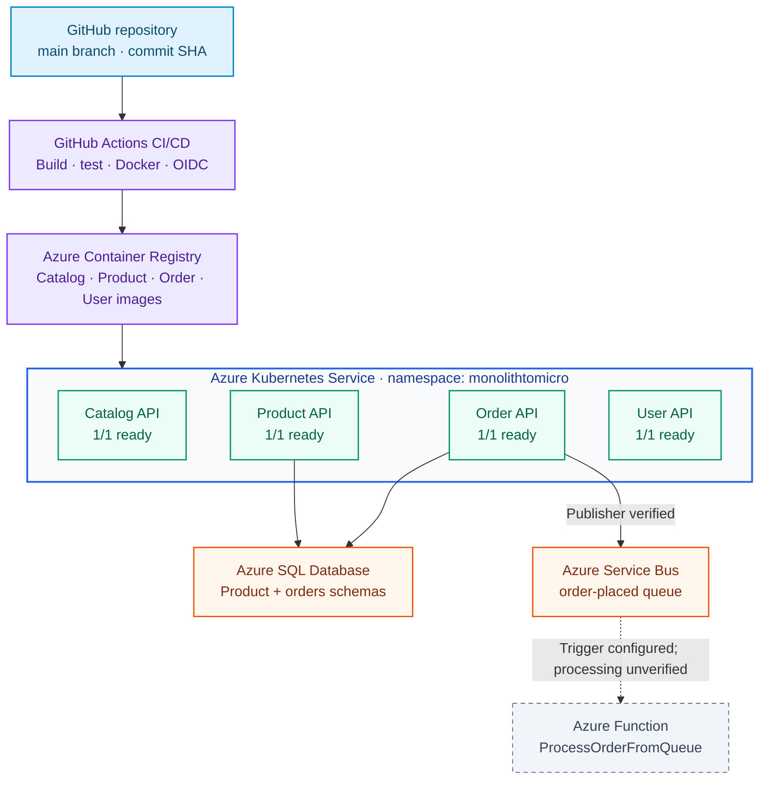
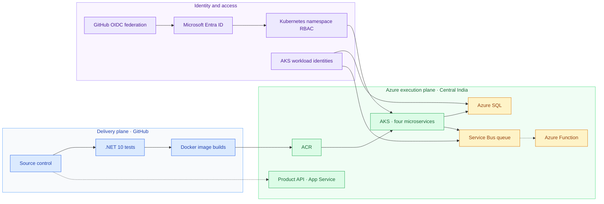
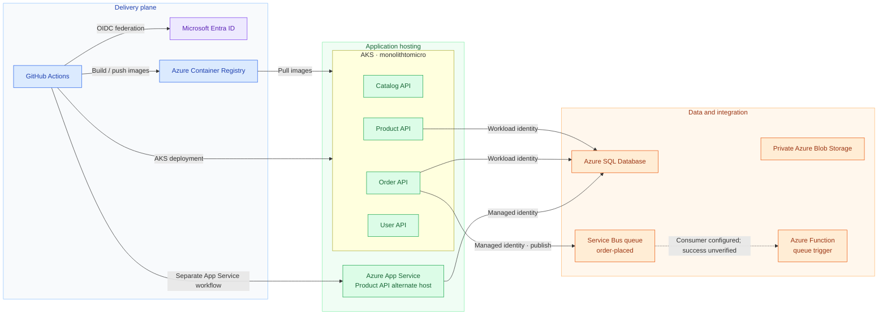
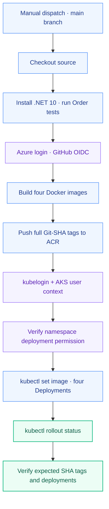
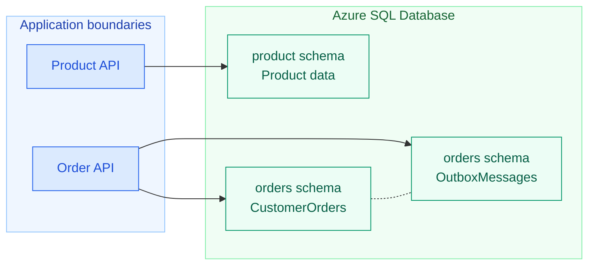
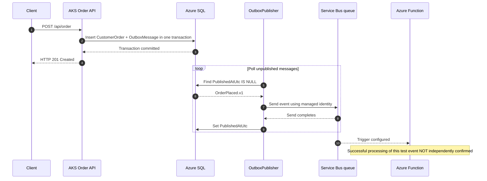
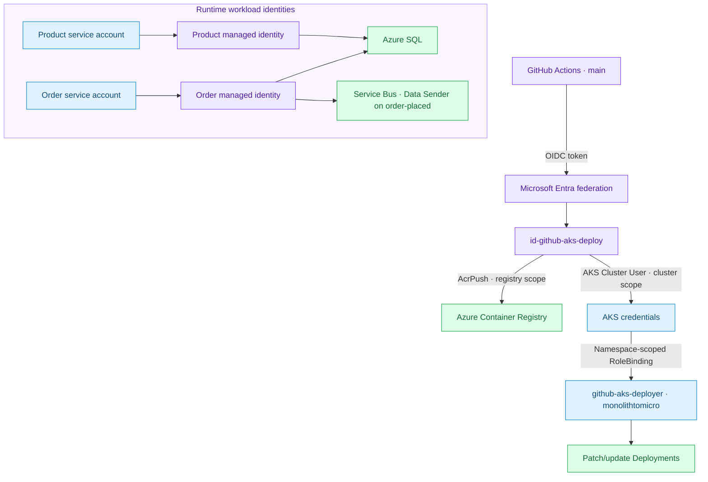

<div align="center">

# MonolithToMicro

### Enterprise Application Modernization · .NET 10 · Azure · Kubernetes · GitHub Actions

**An executable, Azure-hosted microservices and DevOps proof of concept**


[**AKS CI/CD workflow**](.github/workflows/aks-ci-cd.yml) · [**App Service CI/CD workflow**](.github/workflows/product-api-ci-cd.yml) · [**Verified AKS deployment**](https://github.com/Milind300/MonolithToMicro/actions/runs/42902156585)

</div>

> [!IMPORTANT]
> This is a **working architecture-focused proof of concept**, not a completed migration from an existing monolith or a production-ready commerce platform. AKS was **stopped after validation** to control costs. The latest Azure Function consumer invocation was **not independently verified**.

## At a glance

| **4 / 4 APIs** | **4 / 4 healthy pods** | **CI/CD deployed to AKS** | **Service Bus publisher verified** |
|:---:|:---:|:---:|:---:|
| Catalog · Product · Order · User | `1/1` ready each, zero restarts at verification | GitHub Actions Run #2 and Run #3 succeeded | Event ID correlated with SQL outbox |

| Engineering layer | Delivered and observed |
|---|---|
| Application | ASP.NET Core 10, C#, four business-oriented APIs |
| Delivery | .NET tests → Docker build → ACR → AKS rollout verification |
| Security | GitHub OIDC, Microsoft Entra ID, managed identities, namespace-scoped Kubernetes RBAC |
| Data | Azure SQL, EF Core, transactional outbox |
| Messaging | Azure Service Bus sender verified from AKS; Azure Function consumer deployed, invocation unconfirmed |
| Operations | Health checks, rollout status, image SHA verification, deliberate AKS shutdown |

## 1. Current architecture — deployment view

The vertical view below mirrors the **source → pipeline → registry → Kubernetes → data and messaging** design. Each stage is an actual component of the project.



> **Deployment-state note:** The readiness labels describe the **last successful running-state verification**, not live status while AKS is stopped. Only Product and Order Azure SQL paths were functionally tested; the diagram does not imply every service has a verified Azure SQL workload.

## 2. Architectural view — solution architect

This view separates **developer delivery**, **cloud execution**, **data/integration**, and **identity/security boundaries**.



**Architectural decisions**

| Decision | Rationale | Trade-off |
|---|---|---|
| Business-aligned services | Independent application responsibilities and deployments | Increased distributed-system complexity |
| Logical SQL schemas | Service-oriented persistence models within one SQL deployment | Not full physical database isolation |
| Internal `ClusterIP` services | Avoid exposing each API publicly | External access needs ingress/gateway if introduced |
| Transactional outbox | Atomic persistence of order + integration event | Requires polling, retry, idempotency controls |
| GitHub OIDC + managed identities | Removes long-lived Azure credentials from application and CI workflows | Requires federation, RBAC, and credential configuration |
| Manual AKS deployment workflow | Controlled portfolio deployments and Azure spend | No automatic promotion on each commit |

### Azure infrastructure — where, how, and why each resource is used

The architecture separates **delivery**, **application hosting**, **data and messaging**, and **identity and access**. The table explains the **placement**, **actual integration**, and **purpose** of every Azure resource used by this project.

| Azure resource | Where it fits | How this project uses it | Why it is needed |
|---|---|---|---|
| **Azure App Service** | Alternative application-hosting path, separate from AKS | Hosts the Product API deployment from `product-api-ci-cd.yml`; the App Service health and product endpoints were validated | Demonstrates managed PaaS hosting and a simpler deployment model alongside containers |
| **Azure SQL Database** | Data layer, outside the AKS cluster | Product and Order APIs access the Azure SQL serverless database using Microsoft Entra authentication; the `product` and `orders` schemas hold domain data and outbox records | Durable relational persistence, transactions, and consistent order/outbox writes |
| **Azure Blob Storage** | Private object-storage layer | A private blob container was used for a verified upload/download operation; it is **not** a core dependency in the verified AKS order-processing flow | Demonstrates private cloud object storage for file-like content |
| **Azure Container Registry (ACR)** | Container image supply chain, between GitHub Actions and AKS | GitHub Actions builds and pushes four images tagged with the Git commit SHA; AKS pulls the published images | Central registry and traceability of deployed container versions |
| **Azure Kubernetes Service (AKS)** | Application execution and orchestration | Runs Catalog, Product, Order, and User Deployments in the `monolithtomicro` namespace, each with an internal Kubernetes Service | Independent deployments, scheduling, networking, health probes, and controlled rollouts |
| **Microsoft Entra ID** | Shared identity and authentication boundary | Authenticates GitHub's federated deployment identity, AKS administrators, and Product/Order workload identities | Removes dependence on long-lived Azure credentials and supports centrally managed identities |
| **User-assigned managed identities** | CI/CD identity and AKS workload identity | A dedicated GitHub identity pushes images and updates Deployments; separate Product and Order identities access Azure SQL; the Order identity also sends to Service Bus | Separates privileges by workload and enables passwordless Azure service access |
| **Azure Service Bus** | Asynchronous messaging layer, outside AKS | The Order API's `OutboxPublisher` sends `OrderPlaced.v1` events to the `order-placed` **queue** using managed identity | Decouples order persistence from downstream asynchronous processing |
| **Azure Functions** | Serverless event-consumer layer, outside AKS | `ProcessOrderFromQueue` is deployed with a Service Bus trigger; successful handling of the latest test message is **not independently verified** | Demonstrates an event-driven consumer without hosting a dedicated Kubernetes worker |

#### Resource interactions and boundaries



The Blob Storage box is deliberately **not connected to the order-processing flow** because its validated use was a separate storage exercise. Likewise, the Function connection is dotted because consumer execution of the latest published message was not conclusively observed.

#### AKS configuration and network exposure

| Setting | Verified configuration | Operational meaning |
|---|---|---|
| Cluster | `aks-monolithtomicro-day13` | Managed Kubernetes control plane for the four APIs |
| Azure region | Central India | Region hosting the AKS environment |
| Resource group | `rg-monolithtomicro-aks-day13` | Azure resource-management boundary for this AKS deployment |
| Namespace | `monolithtomicro` | Logical workload boundary used for Deployments, Services, and RBAC |
| Authentication | Managed Microsoft Entra integration | Users and CI/CD authenticate through Entra identities |
| Authorization | Native Kubernetes RBAC | GitHub deployer receives namespace-scoped Deployment permissions rather than cluster-admin |
| API exposure | **Four internal `ClusterIP` Services on port `8080`** | Stable in-cluster networking; **no public AKS API endpoint or ingress was configured for these services** |
| Validation access | `kubectl port-forward` | Temporary access from the authenticated developer machine for `/health` and selected API requests |
| Runtime verification | Four Deployments `1/1` Ready, zero pod restarts | Last observed running-state health, **not live status after AKS shutdown** |
| Current AKS state | `Stopped` (provisioning `Succeeded`) | Worker compute stopped after validation to reduce charges; application endpoints are unavailable while stopped |

**Why `ClusterIP`?** It exposes each API **only within the Kubernetes cluster**, reducing accidental internet exposure during a proof of concept. Other pods can address a Service through Kubernetes DNS. Testing was performed through authenticated `kubectl port-forward`, which does **not** publish a permanent public endpoint. If external clients are required later, a separately designed ingress or API gateway, TLS, authentication, and network policies will be needed.

**Service boundary note:** `ClusterIP` controls Kubernetes Service exposure; it does **not** by itself guarantee pod-to-pod traffic isolation, authorize API callers, or make outbound Azure dependencies private. Those are separate network and application security concerns.

## 3. Four microservices

| Service | Responsibility | Verified in AKS |
|---|---|---|
| **Catalog API** | Catalog operations | `GET /health` → HTTP 200 |
| **Product API** | Product inventory / availability | `GET /health` and `GET /api/product` → HTTP 200; SQL-backed product returned |
| **Order API** | Orders, SQL transactions, outbox publisher | `GET /health`, `GET /api/order`, `POST /api/order` and Service Bus publishing verified |
| **User API** | Customer profile API | `GET /health` → HTTP 200 |

The codebase uses controller, application-service, repository, and EF Core patterns where implemented. Services have independent container build definitions. The solution does not claim complete feature parity with a legacy commerce platform.

## 4. CI/CD architecture — DevOps view

Two workflows coexist without overwriting each other:

- **Product API → Azure App Service:** [product-api-ci-cd.yml](.github/workflows/product-api-ci-cd.yml)
- **Four APIs → ACR → AKS:** [aks-ci-cd.yml](.github/workflows/aks-ci-cd.yml)



### Verified GitHub Actions executions

| Run | Commit | Observed outcome |
|---|---|---|
| Initial image publishing | `940c04c` | Four SHA-tagged images pushed to ACR |
| [First end-to-end AKS deployment](https://github.com/Milind300/MonolithToMicro/actions/runs/42902156585) | `cdbe47f` | Both jobs successful; total **4m 11s** |
| [Updated publisher-capable Order API deployment](https://github.com/Milind300/MonolithToMicro/actions/runs/42907582391) | `e8693a3` | Both jobs successful; Service Bus publisher enabled in subsequent AKS configuration |

The workflow deploys images with `kubectl set image` and checks rollouts, preserving existing ServiceAccount and Secret references. It does **not** implement automatic rollback or full application acceptance testing.

## 5. Azure SQL — logical data architecture

The local solution uses SQL Server and domain-oriented schemas; the Azure test verified Product and Order operations against an Azure SQL database.



| Tested API call | Verified response |
|---|---|
| `GET /api/product` | HTTP 200 with `AKS-DEMO-001` product data |
| `GET /api/order` | HTTP 200 with previously stored orders |
| `POST /api/order` | New order inserted and outbox event created |

The first Product SQL-backed request timed out; a subsequent request succeeded while the database was online. The exact cause of the initial delay remains unconfirmed.

## 6. Service Bus — event-driven architecture



### Correlated publishing evidence

| Event field | Verified value |
|---|---|
| Order ID | `b6704cfe-3391-4b60-998a-5f2d6d02c86a` |
| Outbox message ID | `3e844ae6-52f1-47a0-943b-cece8a24289e` |
| Event type | `OrderPlaced.v1` |
| Created at (UTC) | `2026-11-10 21:50:52` |
| Published at (UTC) | `2026-11-10 21:51:03` |

The AKS Order API logged successful publication, and the SQL row had a non-null `PublishedAtUtc` for the **same message**. Service Bus reported **0 active** and **1 previously existing dead-letter** message after the test; the dead-letter count did not increase.

> [!NOTE]
> **Verified:** Order creation → SQL outbox → Azure Service Bus publication from AKS. **Not independently verified:** successful processing of this exact event by `ProcessOrderFromQueue`. The Function trigger is deployed, but its Invocations view required Application Insights, which was not configured. The outbox publication timestamp does **not** serve as consumer acknowledgment.

## 7. Identity, security, and authorization



**Security posture:** No Service Bus connection string is needed in the AKS Order API: it uses `DefaultAzureCredential` with Workload Identity. SQL connection configuration is supplied using existing Kubernetes Secret references; the Secret value must **not** be committed to Git.

**Important boundary:** A namespace-scoped right to modify Deployments is still powerful and can indirectly expose credentials used by those pods. This is a portfolio proof of concept, not a claim of zero-risk production isolation.

## 8. Operational verification — evidence

| Check | Actual result |
|---|---|
| Kubernetes Deployments | Catalog, Product, Order, User all `1/1` Ready |
| Kubernetes pods | Four Running, zero restarts at verification |
| Internal services | Four `ClusterIP` services on port `8080` |
| HTTP health | All four `GET /health` endpoints returned **200 Healthy** |
| Product database | `GET /api/product` returned **200** with product data |
| Order database | `GET /api/order` returned **200** with order data |
| Order creation | `POST /api/order` succeeded; outbox row created |
| Outbox publisher | Explicit `OrderPlaced.v1` success log and SQL published timestamp |
| Azure Function consumer | Trigger configured; latest per-message invocation **not verified** |
| AKS shutdown | `PowerState: Stopped`, `ProvisioningState: Succeeded` |

<details>
<summary><strong>Read-only Kubernetes verification commands</strong></summary>

Run only when AKS is started and your `kubectl` context is authenticated:

```powershell
kubectl get deployments -n monolithtomicro -o wide
kubectl get pods -n monolithtomicro
kubectl get services -n monolithtomicro
kubectl rollout status deployment/order-api -n monolithtomicro
```

</details>

## 9. Repository layout and reproducibility

```text
MonolithToMicro/
├── .github/workflows/
│   ├── product-api-ci-cd.yml
│   └── aks-ci-cd.yml
├── src/
│   ├── MonolithToMicro.Catalog.Api/
│   ├── MonolithToMicro.Product.Api/
│   ├── MonolithToMicro.Order.Api/
│   └── MonolithToMicro.User.Api/
├── tests/MonolithToMicro.Order.Tests/
├── k8s/
│   └── aks/order-api.yaml
├── scripts/
├── Directory.Build.props
├── MonolithToMicro.slnx
└── README.md
```

The tree highlights the **known tracked core paths**, not every local file. Additional AKS manifests, a Function project, setup scripts and troubleshooting materials were present locally but **were not all committed** at the last Git status review. As a result, the entire Azure environment is **not yet reproducible from this repository alone**.

> [!CAUTION]
> Keep private `/docs/` files, local secrets, connection strings, SQL exports, backup snapshots, and other potentially sensitive artifacts out of Git. Review untracked scripts and Kubernetes snapshots individually before publishing. Do not use `git add .` indiscriminately.

### Build and tests

```powershell
dotnet build .\MonolithToMicro.slnx --configuration Release
dotnet test .\tests\MonolithToMicro.Order.Tests\MonolithToMicro.Order.Tests.csproj --configuration Release
```

### Docker build example

```powershell
docker build -f src/MonolithToMicro.Order.Api/Dockerfile -t order-api:local .
```

### CI/CD operation

The AKS workflow currently uses a manual `workflow_dispatch` trigger on `main`. It pushes Git-SHA-tagged images and updates the four existing Kubernetes Deployments. AKS must be running for the deployment stage.

## 10. Troubleshooting — real engineering lessons

<details>
<summary><strong>Microsoft Entra and kubelogin authentication</strong></summary>

After Entra integration was enabled, `kubectl` could not find the `kubelogin` executable. Azure CLI had installed it, but the active PowerShell session did not have its directory in `PATH`. Updating the session PATH and using `kubelogin convert-kubeconfig -l azurecli` restored access. Cloud authentication and Kubernetes authorization were checked separately.

</details>

<details>
<summary><strong>Azure SQL request timeout</strong></summary>

An initial database-backed Product API GET timed out. Azure SQL was subsequently confirmed online, and a retry succeeded with HTTP 200 and product data. An SQL serverless cold start is a possibility, not a proven root cause.

</details>

<details>
<summary><strong>Service Bus dead-letter troubleshooting</strong></summary>

An earlier Function consumer expected a different JSON property shape and a message entered the dead-letter queue. The consumer parser was corrected and republished. Later AKS publisher success was verified, but Function invocation logs were unavailable because Application Insights was not configured.

</details>

<details>
<summary><strong>GitHub Actions and PowerShell tooling</strong></summary>

Initial YAML-writing and local validation attempts failed because of PowerShell quoting/here-string handling and unavailable local parsers. The workflow was saved in VS Code and ultimately verified by real successful GitHub Actions executions. Git whitespace validation does not itself validate YAML semantics.

</details>

<details>
<summary><strong>Configuration drift</strong></summary>

The Service Bus publisher was initially enabled by updating the running Order Deployment environment variables. The corresponding configuration was then recorded in `k8s/aks/order-api.yaml` and committed. The CI/CD deployment uses image updates rather than applying every manifest file.

</details>

## 11. Limitations and next engineering steps

| Area | Current boundary | Next improvement |
|---|---|---|
| Azure Function consumer | No per-message success evidence | Add correlated consumer telemetry or a processed-events record |
| Testing | Existing Order tests run in CI | Expand service-level and integration coverage |
| Rollback | Sequential rollout checks; no automatic rollback | Add rollback strategy and deployment gates |
| Availability | Single-replica PoC | Multi-replica workloads, PDBs and capacity planning |
| Observability | Limited Function invocation history | Structured logs and distributed tracing with cost controls |
| Infrastructure | Some AKS resources provisioned manually | Move to reviewed Bicep/Terraform IaC |
| Security | Trusted `main` workflow and scoped roles | GitHub environment approvals, policy enforcement, image scanning |
| Reproducibility | Some local manifests and Function source untracked | Review and publish non-sensitive infrastructure assets |

## 12. Cost-aware operations

The AKS cluster was **stopped after successful validation**. This suspends worker-node compute but does not delete the cluster or necessarily eliminate charges for Azure Container Registry, storage, networking, SQL, Service Bus, Functions, and related resources.

The Azure promotional credit expiry was reported as **November 19, 2026** during the project. Review Azure Cost Management and remaining chargeable resources before that date. Do not delete AKS managed-resource-group components individually.

## 13. Portfolio outcome

**Verified:** Four independently deployed .NET APIs, real GitHub Actions deployments, Git-SHA-tagged images, AKS rollout and health verification, Azure SQL connectivity, and Azure Service Bus outbox publication from AKS.

**Not claimed:** A completed legacy migration, production readiness, comprehensive high availability, or independently verified processing of the latest test event by Azure Functions.

This project demonstrates **solution architecture, production-oriented .NET engineering practices, and hands-on Azure DevOps delivery**, with explicit evidence and stated limitations.

---

<div align="center">

**Source-controlled architecture · Passwordless CI/CD · Verified Azure deployments · Cost-aware operations**

</div>
